<div align="center">

```
▓   ▓  ▓▓▓  ▓   ▓  ▓▓▓▓ ▓▓▓▓▓ ▓▓▓▓▓     ▓▓▓   ▓▓▓▓  ▓▓▓  ▓   ▓  ▓▓▓  
 ▓ ▓  ▓   ▓ ▓   ▓ ▓     ▓     ▓        ▓   ▓ ▓     ▓   ▓ ▓▓ ▓▓ ▓   ▓ 
  ▓   ▓   ▓ ▓   ▓  ▓▓▓  ▓▓▓▓  ▓▓▓▓     ▓   ▓  ▓▓▓  ▓▓▓▓▓ ▓ ▓ ▓ ▓▓▓▓▓ 
  ▓   ▓   ▓ ▓   ▓     ▓ ▓     ▓        ▓   ▓     ▓ ▓   ▓ ▓   ▓ ▓   ▓ 
  ▓    ▓▓▓   ▓▓▓  ▓▓▓▓  ▓▓▓▓▓ ▓         ▓▓▓  ▓▓▓▓  ▓   ▓ ▓   ▓ ▓   ▓
```

</div>

## 👋 About Me

Hi, I'm **Yousef Osama**, a software engineer who builds solid backend systems, clean APIs, and AI-powered workflows.

- 🎓 Senior Software Engineering Student at **Egypt University of Informatics (EUI)** (Cairo, Egypt).
- ⚙️ Focused on **Backend Systems, API Design, and AI/LLM Orchestration**, from RESTful services to semantic data pipelines and LangGraph/LangChain workflows.
- 🏦 Past Experience: **Frontend Developer Intern @ Attijariwafa Bank** (Digital Team) & **Summer Intern @ Commercial International Bank (CIB)** (Digital Banking & AI Applications).
- 🔭 Currently building **AlgoArena**, a gamified competitive coding platform.

## 💻 Tech Stack

**Languages**

<p>
  
  
  
  
  
  
  
  
  
</p>

**Frameworks & AI**

<p>
  
  
  
  
  
  
</p>

**Databases & Semantic Web**

<p>
  
  
  
  
</p>

**Tools & OS**

<p>
  
  
  
  
  
  
  
</p>

## 🚀 Featured Work & In-Progress

- **⚔️ [AlgoArena](https://github.com/YousefOsamaMahmoud/AlgoArena)** *(In Active Development)*: A gamified competitive coding platform featuring AI-generated challenges and sandboxed code execution.
- **🧠 [Semantic Digital Twin Engine](https://github.com/YousefOsamaMahmoud/semantic-digital-twin-backend)**: Real-time supply chain risk detection engine built with Python, FastAPI, LangGraph, GraphDB/Neo4j, and Google Gemini NLP pipelines for SLA contract extraction.

## 📈 Contribution Graph

<p align="center">
  <picture>
    <source media="(prefers-color-scheme: dark)" srcset="https://raw.githubusercontent.com/YousefOsamaMahmoud/YousefOsamaMahmoud/output/github-contribution-grid-snake-dark.svg" />
    <source media="(prefers-color-scheme: light)" srcset="https://raw.githubusercontent.com/YousefOsamaMahmoud/YousefOsamaMahmoud/output/github-contribution-grid-snake.svg" />
    
  </picture>
</p>

## 🌐 Connect with Me

<p>
  <a href="https://www.linkedin.com/in/yousef-rabiee"></a>
  <a href="mailto:yousefrabie.work@gmail.com"></a>
  <a href="https://github.com/YousefOsamaMahmoud"></a>
</p>

- **LinkedIn:** [linkedin.com/in/yousef-rabiee](https://www.linkedin.com/in/yousef-rabiee)
- **Email:** [yousefrabie.work@gmail.com](mailto:yousefrabie.work@gmail.com)
- **GitHub:** [YousefOsamaMahmoud](https://github.com/YousefOsamaMahmoud)

---

<p align="center">
  I'm always open to new software engineering opportunities, backend/AI collaborations, and building impactful systems. Let's connect! 🚀
</p>
